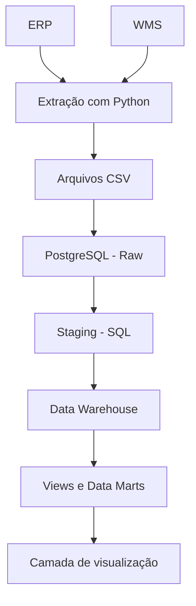

# Logistics Data Platform

**Plataforma de dados para integração, processamento e análise de operações logísticas.**

O Logistics Data Platform é um projeto de Engenharia de Dados que simula a construção de uma plataforma analítica para operações logísticas, integrando dados de sistemas ERP (*Enterprise Resource Planning*) e WMS (*Warehouse Management System*).

O objetivo é desenvolver um fluxo de dados estruturado, desde a extração de dados operacionais até sua transformação e disponibilização para análises, aplicando práticas de ingestão, organização em camadas, modelagem de dados e automação de pipelines.

O projeto é desenvolvido incrementalmente, com foco em organização, confiabilidade, rastreabilidade e separação de responsabilidades ao longo do processamento.

## Arquitetura

A plataforma está sendo construída com uma arquitetura em camadas, separando a ingestão dos dados, as transformações e a disponibilização analítica.

Cada etapa possui uma responsabilidade específica:

- **Fontes de dados:** sistemas ERP e WMS com informações operacionais.
- **Extração e ingestão:** scripts Python responsáveis pela extração, geração de arquivos intermediários e carregamento dos dados.
- **Raw:** armazenamento inicial dos dados no PostgreSQL, organizados por origem.
- **Staging:** preparação e padronização dos dados para as etapas analíticas.
- **Data Warehouse:** modelagem dimensional para análise das operações logísticas.
- **Views e Data Marts:** estruturas voltadas à organização e ao consumo analítico dos dados.
- **Visualização:** camada destinada à exploração dos indicadores e resultados processados.

*As etapas posteriores à ingestão fazem parte da arquitetura planejada e serão implementadas progressivamente.*

## Tecnologias

| Tecnologia | Aplicação |
|---|---|
| Python | Extração, processamento e automação |
| Pandas | Manipulação e preparação dos dados |
| PostgreSQL | Armazenamento e estruturação das camadas de dados |
| Psycopg 3 | Conexão e carregamento de dados no PostgreSQL |
| SQL | Transformação, consultas e modelagem analítica |
| Git e GitHub | Versionamento e documentação do projeto |
| Streamlit | Visualização dos resultados, prevista para uma etapa futura |

## Implementação

### 1. Extração dos dados

Desenvolvimento de scripts Python para extrair informações dos sistemas de origem e gerar arquivos CSV que servem como intermediários entre a extração e a ingestão no banco de dados.

A separação por origem permite organizar o processamento e tratar as particularidades de cada sistema.

### 2. Ingestão no PostgreSQL

Implementação de rotinas de carregamento utilizando Psycopg 3 e o comando `COPY FROM STDIN`, voltado à transferência eficiente de dados para o PostgreSQL.

Os dados são carregados na camada `raw`, com tabelas organizadas de acordo com sua origem.

O processo também considera aspectos como compatibilidade de tipos de dados, integridade das cargas e controle transacional.

### 3. Transformação e modelagem analítica

A próxima etapa consiste em desenvolver as transformações SQL necessárias para padronizar os dados, estruturar o Data Warehouse e preparar conjuntos de dados para análises logísticas.

A proposta é utilizar Python para controlar os processos de ingestão e SQL para concentrar as transformações e a modelagem analítica.

### 4. Disponibilização dos dados

Após a construção das estruturas analíticas, a plataforma deverá disponibilizar indicadores e consultas voltados à exploração das operações logísticas, com uma camada de visualização desenvolvida em Streamlit.

## Objetivos técnicos

- Integrar dados provenientes de sistemas operacionais distintos.
- Desenvolver pipelines de extração e ingestão com Python.
- Aplicar estratégias eficientes de carregamento em bancos de dados.
- Organizar os dados em camadas com responsabilidades bem definidas.
- Desenvolver transformações SQL e modelagem dimensional.
- Estabelecer práticas de consistência, rastreabilidade e manutenção dos pipelines.
- Preparar os dados para consumo analítico e visualização.

## Status do projeto

**Em desenvolvimento.**

A extração dos dados do ERP já foi implementada, e a rotina de carregamento dos dados para a camada raw já foi finalizada.

As próximas etapas envolvem consolidar a ingestão, implementar as transformações SQL, construir o Data Warehouse e disponibilizar os resultados para análise.

## Sobre o projeto

O Logistics Data Platform é um projeto de portfólio desenvolvido para aprofundar conhecimentos práticos em Engenharia de Dados, explorando decisões de arquitetura, processamento de dados e construção de pipelines.

O foco está na implementação de uma solução organizada e evolutiva, priorizando a compreensão dos processos e a aplicação de fundamentos técnicos em vez de apenas reunir ferramentas em uma stack.

---

**Desenvolvido por Lucas Felix Santos**

[LinkedIn](https://www.linkedin.com/in/dalucasfelixsantos/) · [E-mail](mailto:lucasfelixsantos2002@outlook.com)
